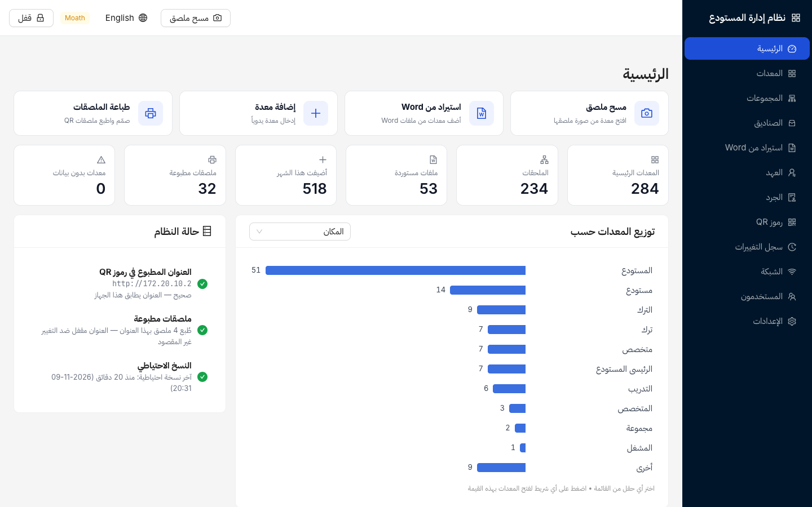
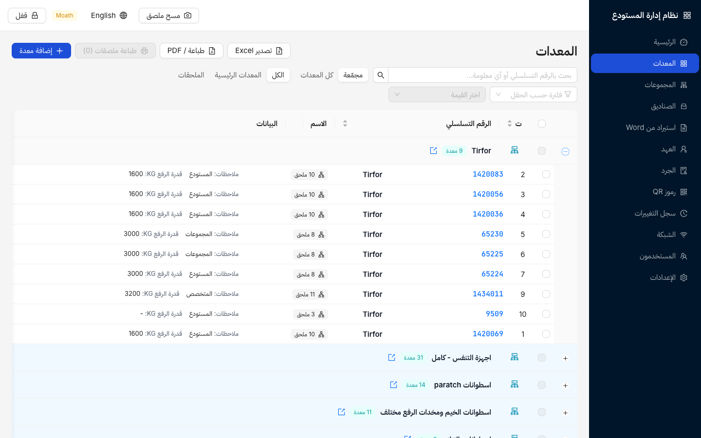
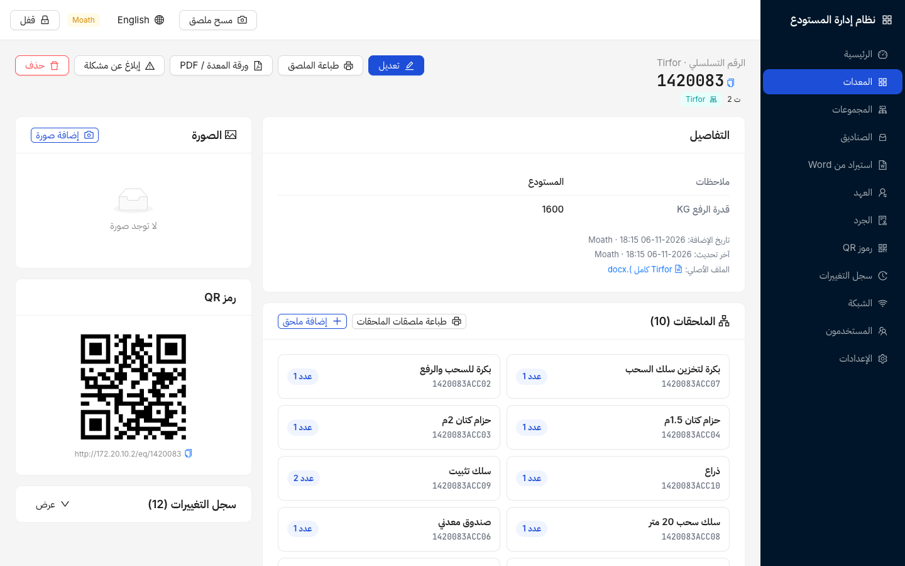
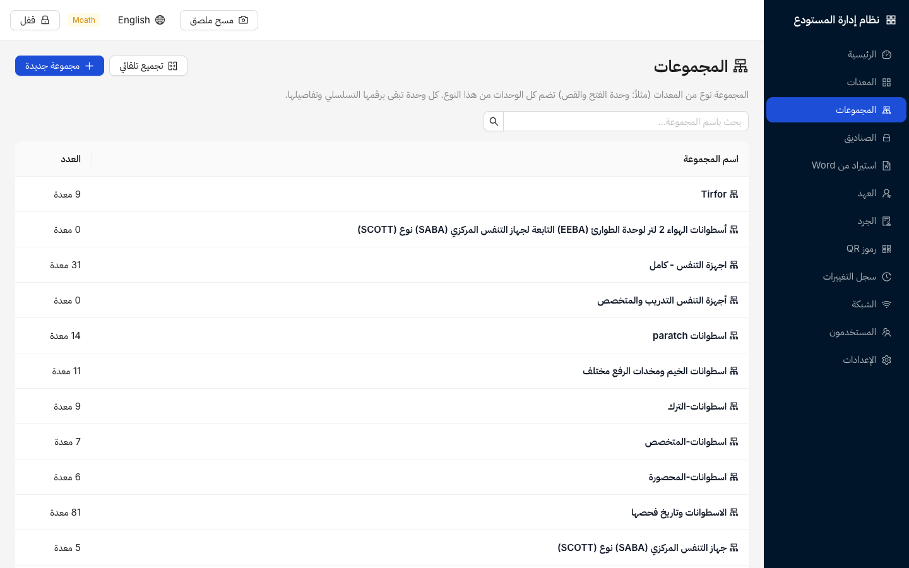
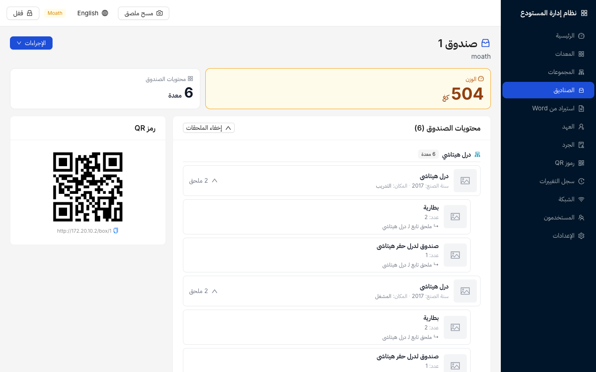
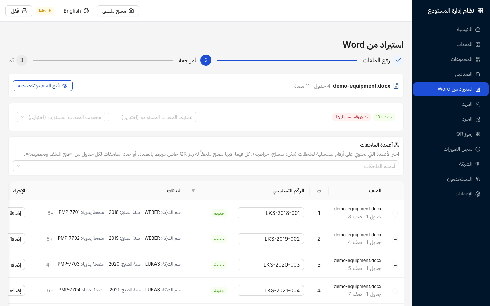
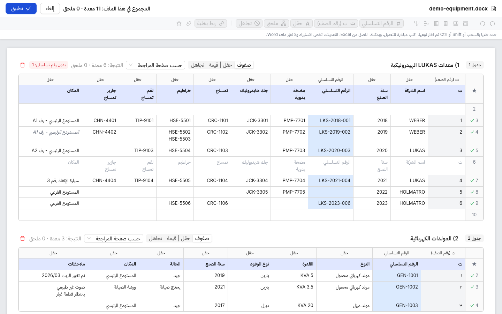
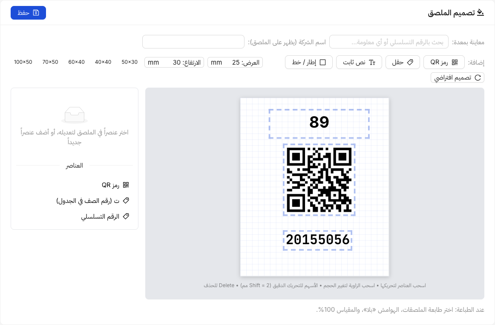
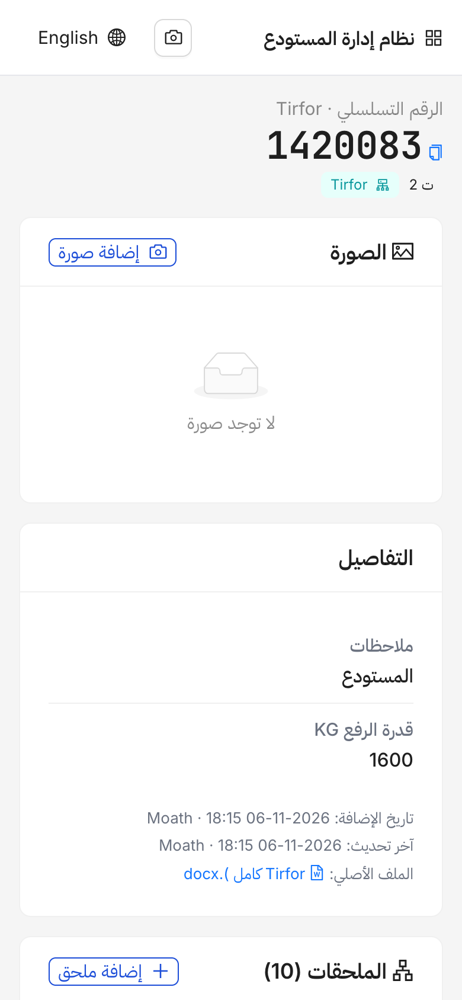
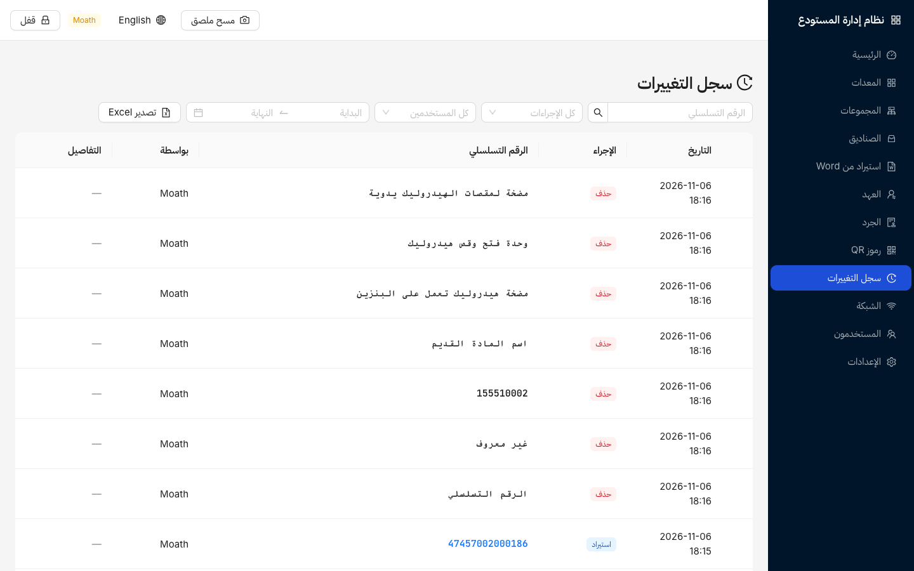

<div dir="rtl">

# نظام إدارة المستودع

نظام لتسجيل معدات المستودع وتتبعها: استيراد البيانات من ملفات Word، وملصقات QR تفتح صفحة المعدة من كاميرا أي هاتف، والملحقات والمجموعات والصناديق، والعهد والجرد والصيانة، مع سجل كامل لكل تغيير.

- يعمل **دون إنترنت** على الشبكة المحلية.
- واجهة عربية (من اليمين إلى اليسار) وإنجليزية.
- **التقنيات:** Laravel 13 (واجهة API)، و React (Vite و Ant Design)، و MySQL.

[English version](README.en.md)



## المزايا

### الصفحة الرئيسية

- اختصارات سريعة: مسح ملصق، استيراد من Word، إضافة معدة، طباعة الملصقات. وبطاقات أرقام يُضغط عليها لفتح القائمة المقصودة.
- مخطط «توزيع المعدات حسب» أي حقل: الضغط على أي شريط يفتح قائمة المعدات مفلترة بتلك القيمة.
- حالة النظام: العنوان المطبوع في رموز QR، والملصقات المطبوعة، وآخر نسخة احتياطية.
- «تحتاج انتباه»: المعدات التي تحتوي بياناتها على كلمات تحددها في الإعدادات.
- آخر المعدات والاستيرادات، ورمز QR يفتح النظام على الهاتف، ونشاط آخر 30 يوماً (بعد إدخال الرمز السري).

### المعدات



- البحث في أي قيمة، والفلترة حسب أي حقل، وإضافة المعدات وتعديلها وحذفها. الحقول مرنة: لكل معدة حقولها الخاصة.
- عرض مجمّع (صف لكل مجموعة يُفتح على وحداتها) أو عرض كل المعدات.
- **التعديل الجماعي** للمعدات المحددة: تعيين حقل أو حذفه، أو تعيين التصنيف أو المجموعة.
- **أسماء الحقول** (في الإعدادات): دمج المفاتيح أو إعادة تسميتها في كل مكان، بما في ذلك تصميم الملصق.
- **التصدير**:
  - Excel (من اليمين إلى اليسار، عمود لكل حقل) لقائمة المعدات بنفس البحث والفلاتر، ولسجل التغييرات.
  - PDF عبر صفحات الطباعة (ورقة بيانات المعدة وقائمة المعدات) وخيار «حفظ بصيغة PDF» في المتصفح.

### صفحة المعدة والملحقات



- **الملحقات**: الملحق معدة كاملة (لها حقولها وصفحتها) مرتبطة دائماً بمعدة رئيسية واحدة.
  - الرقم التسلسلي للملحق بلا قيود: قد يتكرر أو يكون فارغاً. الرقم يجب أن يكون فريداً للمعدات الرئيسية فقط.
  - ملصق QR يحتاج رقماً تسلسلياً. عند تكرار الرقم، يفتح المسح أو البحث المعدة الرئيسية أولاً.
  - تُضاف الملحقات من صفحة المعدة، أو تُنشأ عند الاستيراد من الأعمدة التي تختارها. حذف المعدة الرئيسية يحذف ملحقاتها.
- **صورة المعدة**: صورة واحدة لكل معدة، تُصغَّر على الجهاز قبل الرفع. يراها الجميع، وإضافتها أو حذفها تحتاج الرمز السري.
- **الصيانة والتواريخ**: مواعيد لكل معدة تتكرر كل عدد من الأشهر. زر «تم» يسجّل العمل وينقل الموعد إلى الأمام. المستحق والمتأخر يظهر في الصفحة الرئيسية.
- **إبلاغ عن مشكلة**: أي شخص يمسح الملصق يمكنه الإبلاغ عن عطل مع صورة، دون رمز سري. إغلاق البلاغ يحتاج الرمز السري. الصور تدخل في النسخ الاحتياطية.

### المجموعات



- المجموعة نوع من المعدات، مثل «وحدة الفتح والقص»، تضم كل الوحدات من هذا النوع. كل وحدة تحتفظ برقمها التسلسلي وتفاصيلها.
- تُجمَّع المعدات الرئيسية فقط، وكل معدة في مجموعة واحدة على الأكثر. الملحقات تبقى تحت معدتها الرئيسية.
- **التجميع التلقائي** يقترح مجموعات من المعدات التي تتشارك الاسم (مع تجاهل اختلاف الإملاء)، ولا يطبّقها إلا بعد تأكيدك.
- المعدة الجديدة أو المستوردة تنضم إلى المجموعة التي تحمل اسمها.
- حذف المجموعة يُبقي معداتها، بلا مجموعة.

### الصناديق



- صندوق مرقّم له اسم ووزن وملصق QR خاص (<code dir="ltr">/box/&lt;الرقم&gt;</code>) يفتحه أي هاتف. العرض متاح للجميع، والتغيير يحتاج الرمز السري.
- يمكن أن تكون المعدة في عدة صناديق، والمعدة الرئيسية تدخل الصندوق وتخرج منه مع ملحقاتها.
- أضف معدة جديدة، أو اختر معدات موجودة، أو أضف مجموعة كاملة دفعة واحدة. المحتويات مرتبة حسب المجموعة، مع زر **إخراج المجموعة**.
- صفحة الصندوق تعرض الرقم والاسم، والوزن وعدد المعدات بخط كبير، وصورة كل معدة واسمها وحتى 3 من تفاصيلها. كل الإجراءات في قائمة **الإجراءات**.
- حذف الصندوق يُبقي معداته. الإدخال إلى الصندوق والإخراج منه يُسجَّلان في سجل التغييرات.
- **ورقة الصندوق**: صفحة الصندوق على ورقة A4، ورمز QR في الزاوية اليسرى بجانب اسم الصندوق. اطبعها، أو نزّلها PDF أو ملف Word قابلاً للتعديل.

### الاستيراد من Word

ارفع ملفاً أو عدة ملفات ‎`.docx`. كل جدول في الملف يُقرأ وحده، ثم تراجع النتيجة قبل الحفظ.



- المراجعة تعرض المعدات **الجديدة** و**الموجودة مسبقاً** والتي **بدون رقم تسلسلي**. للموجودة مسبقاً تختار الاستبدال أو التخطي.
- يمكنك اختيار مجموعة للمعدات المستوردة (الجديدة والمستبدلة). زر **استيراد من Word** في صفحة مجموعة يفتح الاستيراد مع اختيار تلك المجموعة.
- يمكن رفع ملفات كثيرة دفعة واحدة: تُرسل على دفعات، ويظهر التقدم على زر القراءة.

زر **فتح الملف وتخصيصه** يفتح جداول الملف في صفحة كاملة كما تبدو في Word:



التفاصيل في [قواعد الاستيراد من Word](#قواعد-الاستيراد-من-word) أدناه. للتجربة توجد ملفات نموذجية في مجلد `samples`.

### ملصقات QR



- كل رمز QR يحمل رابطاً مثل <code dir="ltr">http://&lt;عنوان-الجهاز&gt;/eq/&lt;الرقم-التسلسلي&gt;</code>. كاميرا أي هاتف تفتحه دون أي تطبيق.
- **تصميم الملصق**: لوحة تسحب فيها العناصر وتغيّر حجمها: رموز QR، والحقول (الرقم التسلسلي، الاسم، ت، رقم المعدة الرئيسية، اسم الشركة، أو أي حقل من Word مع بادئة)، والنص الثابت، والإطارات.
  - لكل نص حجم خط، وخط عريض، ومحاذاة، وتصغير ليناسب المساحة، والتفاف.
  - المواضع بالمليمتر مع خطوة 0.5 مم، والأسهم للتحريك الدقيق.
  - معاينة بمعدة حقيقية. التصميم يُحفظ ويُستخدم كما هو عند الطباعة.
- طباعة الملصقات للمعدات المحددة أو لكل نتائج البحث والفلترة، بمقاس طابعة الملصقات.
- **مسح ملصق**: تفتح الكاميرا مباشرة على https، أو بالتقاط صورة على http. تقرأ رموز QR و Data Matrix:
  - ملصق QR من النظام يفتح صفحة المعدة أو الصندوق، حتى لو كان الملصق يحمل عنواناً قديماً.
  - أي رمز آخر، مثل رمز Data Matrix الموجود على المعدة من المصنع، يُبحث عنه في الأرقام التسلسلية وكل الحقول، وفي أرقام الصناديق وأسمائها: المعدات والملحقات والصناديق. نتيجة واحدة تُفتح مباشرة، وأكثر من نتيجة تظهر كقائمة. يُبحث أولاً عن تطابق كامل، ثم عن القيم التي تحتوي الرمز.
  - يمكن أيضاً كتابة الرمز أو الرقم التسلسلي.

### على الهاتف

مسح الملصق بكاميرا الهاتف يفتح صفحة المعدة أو الصندوق مباشرة:

<p align="center">
  
  &nbsp;&nbsp;
  
</p>

### العمل دون اتصال على الهاتف

- من صفحة **العمل دون اتصال** ينزّل الهاتف كل المعدات والملحقات والصناديق ومواعيد الصيانة وبلاغات الأعطال، ومعها الصور إن اخترت ذلك.
- بعدها، والهاتف غير متصل بالنظام، مسح الملصق بكاميرا الهاتف يفتح صفحة المعدة أو الصندوق، مع شريط أصفر **دون اتصال** يعرض تاريخ البيانات. وصفحة **مسح ملصق** تبحث عن رموز Data Matrix في البيانات المحفوظة على الهاتف.
- للعرض فقط: التعديل والإبلاغ عن الأعطال يحتاجان الاتصال. سجل التغييرات وأسماء مستلمي العهد لا تُحفظ على الهاتف أبداً.
- الهواتف تسمح بذلك على **https** فقط: شغّل `start/windows/https-setup.ps1` على Windows أو `start/macOS/START.command` على Mac، وثبّت شهادته مرة واحدة على كل هاتف (الصفحة تشرح الطريقة). يصبح عنوان QR هو <code dir="ltr">https://repo.local</code>، والملصقات المطبوعة به فقط تفتح دون اتصال.
- نزّل البيانات من جديد قبل كل خروج. على الآيفون قد يحذف Safari البيانات إذا لم يُفتح النظام نحو أسبوع.

### العهد والجرد

- **العهد**: تسليم معدة (مع ملحقاتها إن أردت) مع تاريخ إرجاع، ثم استلامها عند الإرجاع.
  - تبويب **العهد** يعرض من يحمل ماذا، مع إبراز المتأخر في الإرجاع.
  - أسماء المستلمين تظهر فقط بعد إدخال الرمز السري.
  - تُطبع العهدة على نموذج من **نماذج العهدة**.
- **الجرد**: ابدأ جرداً لكل المعدات أو لمكان محدد بالفلترة.
  - امسح بقارئ USB، أو بكتابة الرقم ثم Enter، أو بصورة الملصق.
  - النتائج مباشرة: موجود، مفقود، في غير مكانه، غير معروف. مع تصدير Excel.

### سجل التغييرات والرمز السري



- **رمز سري (PIN) لكل شخص**: العرض متاح للجميع، وأي تغيير يطلب رمز الشخص. سجل التغييرات يحفظ من غيّر ماذا ومتى.
- المعدات المحذوفة لا تُمسح من قاعدة البيانات (حذف ناعم)، وكل تغيير في السجل.

### الشبكة وعنوان QR ثابت

- صفحة **الشبكة**:
  - تعرض كل العناوين التي يمكن الوصول إلى الخادم عليها، كروابط مع رمز QR قابل للمسح، واختبار للوصول، وزر **استخدام للـ QR** الذي يحدد العنوان المطبوع في الملصقات.
  - تنبّه عندما لا يطابق عنوان الملصقات هذا الجهاز، مثلاً بعد تغيّر عنوان IP.
  - تعرض الأجهزة التي فتحت النظام (نوع الجهاز، المستخدم، آخر ظهور). يمكن للمدير تسمية الأجهزة أو حظرها.
- **عنوان لا يتغير بعد طباعة الملصقات**:
  - في صفحة الشبكة دليل إعداد لقسم IT جاهز للطباعة، فيه اسم هذا الجهاز وعنوان IP و MAC والمنفذ: حجز DHCP، واسم DNS (موصى به، مثل `http://repo`)، وأمر الجدار الناري، واختبار الهاتف.
  - كل عملية طباعة تَعُدّ ملصقاتها لكل عنوان QR. بعد وجود ملصقات، تغيير العنوان يُظهر عدد الملصقات التي ستتوقف عن العمل، ويتطلب كتابة العنوان الجديد للتأكيد.

## المجلدات

| المجلد | المحتوى |
|---|---|
| `backend` | واجهة Laravel API، ويقدّم أيضاً لوحة التحكم المبنية من `backend/public/app` |
| `frontend` | كود React (مطلوب فقط لتعديل الواجهة) |
| `start/windows` | سكربتات تثبيت النظام وتشغيله على حاسوب Windows |
| `start/macOS` | ملفات تشغيل النظام على جهاز Mac (نقر مرتين) |
| `samples` | ملفات Word نموذجية لتجربة الاستيراد |
| `docs/screenshots` | صور هذا الملف |

## التثبيت على حاسوب Windows (XAMPP ونقاط اتصال الهاتف)

اتبع الملف **`start/windows/START-HERE.txt`** (بالعربية) خطوة بخطوة: التثبيت، والشبكة، واختبار الهاتف، و https، والنسخ الاحتياطي، والطباعة.

- **XAMPP**: قاعدة البيانات MySQL منه، والنظام في <code dir="ltr">C:\repo</code> يعمل بـ PHP 8.3+ من <code dir="ltr">C:\php</code> عبر `start-server.bat`. بعد `https-setup.ps1` يصبح Apache من XAMPP أمام النظام على http و https.
- **Laragon**: بديل، في ملحق آخر الدليل.

رموز QR تحمل اسم الحاسوب **<code dir="ltr">https://repo.local</code>** (mDNS)، فتعمل على أي نقطة اتصال هاتف حتى لو تغيّر عنوان IP. الخطة البديلة إن لم يفتح الهاتف عناوين ‎`.local`: يكون الحاسوب نفسه نقطة الاتصال، بالعنوان الثابت `192.168.137.1`.

| الملف في مجلد `start/windows` | عمله |
|---|---|
| `START-HERE.txt` | دليل يوم التثبيت |
| `setup.bat` | يثبّت النظام: قاعدة البيانات، والجداول (يضيف فقط ولا يعيد الإنشاء أبداً)، وأول مدير، وأول نسخة احتياطية |
| `start-server.bat` | يشغّل النظام بـ PHP (تبقى نافذته مفتوحة): على المنفذ 80، أو على <code dir="ltr">127.0.0.1:8000</code> خلف Apache بعد `https-setup.ps1` مع XAMPP |
| `hotspot-setup.ps1` | PowerShell (كمسؤول): يغيّر اسم الحاسوب إلى `repo`، ويفعّل mDNS، ويفتح الجدار الناري على كل الشبكات، ويمنع السكون، ويحدد عنوان QR |
| `https-setup.ps1` | PowerShell (كمسؤول): شهادة النظام لـ https، والمنفذ 443، وعنوان QR <code dir="ltr">https://repo.local</code>. مطلوب لتفتح الهواتف الملصقات دون اتصال. مع **XAMPP** يضع Apache الخاص به أمام النظام (http على 80 و https على 443)، ويشغّل `start-server.bat` النظام بعدها على <code dir="ltr">127.0.0.1:8000</code>. مع **Laragon** يفحص Apache الخاص به |
| `apache-proxy.conf` | إعدادات Apache التي يضعها `https-setup.ps1` في XAMPP (لا تُنسخ يدوياً) |
| `apache-vhost.conf` | لـ Laragon فقط: يُنسخ إلى `C:\laragon\etc\apache2\sites-enabled\00-repo.conf` (جزء https فيه يعمل بعد `https-setup.ps1`) |
| `backup.bat` / `schedule-backup.bat` | نسخة احتياطية الآن / نسخة احتياطية يومية الساعة 14:00 |
| `update.bat` | بعد نسخ إصدار جديد: نسخة احتياطية أولاً، ثم تحديثات قاعدة البيانات |
| `find-php.bat` | يجد PHP 8.3+ في PATH أو <code dir="ltr">C:\php</code> (تستخدمه السكربتات الأخرى) |

أول مدير يُنشأ بالرمز السري `1234`. غيّره من صفحة **المستخدمون** بعد أول دخول.

### حماية البيانات

- **النسخ الاحتياطي**: قاعدة البيانات، وملفات Word الأصلية، وصور المعدات وبلاغات الأعطال، وقوالب نماذج العهدة، في ملف zip واحد.
  - تُنشأ تلقائياً مرة كل يوم أثناء استخدام النظام، وبالمهمة المجدولة، وعند تشغيل `update.bat`، ومن **الإعدادات ← النسخ الاحتياطي ← نسخة احتياطية الآن**.
  - تُحذف الأقدم عند تجاوز عدد النسخ المحفوظة (الافتراضي 30).
- **مجلد النسخ الاحتياطية**: حدده في الإعدادات على قرص آخر أو فلاشة USB أو مجلد مشترك على الشبكة.
- **الاسترجاع**: `php artisan repo:restore`. تُحفظ نسخة من البيانات الحالية أولاً، فلا يضيع شيء عند الاسترجاع.
- مع `APP_ENV=production` يرفض Laravel الأوامر `migrate:fresh` و `migrate:refresh` و `migrate:reset` و `db:wipe`.

## التشغيل على Mac (https ونقاط اتصال الهاتف)

انقر مرتين على الملفات في المجلد `start/macOS` من Finder. تحتاج PHP 8.3 أو أحدث (`brew install php`) و MySQL من XAMPP أو Homebrew أو DBngin. خادم الويب هو Apache المدمج في macOS، فلا يُستخدم Apache الخاص بـ XAMPP (يوقفه `START.command` إن كان يشغل المنفذين 80 و 443).

| الملف في مجلد `start/macOS` | عمله |
|---|---|
| `START.command` | يشغّل كل شيء. اترك نافذة Terminal مفتوحة، فإغلاقها يوقف النظام. MySQL، وشهادة https، و Apache على http 80 و https 443 أمام النظام، وتحديثات قاعدة البيانات، ثم النظام على <code dir="ltr">127.0.0.1:8000</code>. في أول مرة ينشئ الملف `backend/.env` |
| `network-setup.command` | مرة واحدة، و `START.command` يعمل: يسمّي جهاز Mac باسم `repo` على الشبكة (Bonjour)، فتفتح الهواتف **<code dir="ltr">https://repo.local</code>** على أي نقطة اتصال مهما تغيّر عنوان IP. ويسمح لـ Apache في الجدار الناري، ويجعل هذا العنوان عنوان QR |
| `common.sh` | يستخدمه الملفان السابقان (يجد PHP و Apache) |

الشهادة في المجلد `backend/storage/https` كما في Windows. انسخ هذا المجلد بين الحاسوبين، فلا تحتاج الهواتف شيئاً جديداً.

## طباعة الملصقات

استخدم صفحة **رموز QR**، أو حدد معدات في **المعدات** ثم **طباعة ملصقات**.

- كل ملصق يُطبع كصفحة واحدة بمقاس الملصق (يُحدد في صفحة رموز QR).
- في نافذة الطباعة: اختر طابعة الملصقات، واجعل الهوامش «بلا» والمقياس 100%.
- إن كان لتعريف الطابعة إعداد خاص لمقاس الورق، فاجعله بمقاس الملصق نفسه.

ملصقات الصناديق تُطبع من صفحة **الصناديق** أو من قائمة **الإجراءات** في الصندوق: رمز QR فقط، بأكبر حجم يسمح به الملصق، ملصق واحد في كل صفحة. مقاسها يُختار في صفحة الطباعة ويُحفظ على ذلك الحاسوب.

## التطوير (على Mac)

الخادم: يستخدم MySQL من XAMPP (شغّل MySQL في XAMPP أولاً)، وقاعدة البيانات `equipment_repo`. يعمل على `http://127.0.0.1:8000`.

</div>

```bash
cd backend && php artisan migrate --seed && php artisan serve
```

<div dir="rtl">

البدء من جديد بقاعدة بيانات فارغة (**يحذف كل البيانات!**):

</div>

```bash
php artisan migrate:fresh --seed
```

<div dir="rtl">

الواجهة مع التحديث الفوري، على `http://localhost:5173` (توجّه طلبات <code dir="ltr">/api</code> إلى المنفذ 8000):

</div>

```bash
cd frontend && npm install && npm run dev
```

<div dir="rtl">

بناء لوحة التحكم في `backend/public/app` (قبل النسخ إلى حاسوب Windows):

</div>

```bash
cd frontend && npm run build
```

<div dir="rtl">

الملف `composer.json` يثبّت منصة PHP على الإصدار 8.3، لذا يعمل مجلد `vendor` أيضاً مع PHP على حاسوب Windows.

## قواعد الاستيراد من Word

### محرر الجداول («فتح الملف وتخصيصه»)

بعد الرفع اضغط **فتح الملف وتخصيصه**. يفتح جداول الملف في صفحة كاملة كما تبدو في Word، مع شريط أدوات فوقها. التغييرات تخص هذا الاستيراد فقط، ولا يتغير ملف Word.

- **التعديل**: اكتب في أي خلية، وأدرج الصفوف والأعمدة أو احذفها، والصق مجموعة خلايا من Excel، وتراجع بـ Ctrl+Z. زر **جدول جديد** يضيف جدولاً خاصاً بك.
- **التحديد بالفأرة**: اسحب، أو استخدم Shift و Ctrl. رقم الصف أو رأس العمود يحدد السطر كاملاً.
  - ثم اختر نوعاً للتحديد: رقم تسلسلي، ت، حقل، ملحق، أو تجاهل.
  - تحديد خلية العنوان أو كل عناصر العمود يحدد نوع العمود كله. تحديد خلايا أقل يحدد تلك الخلايا فقط.
- **ربط بخلية**: حدد خلية، واضغط **ربط بخلية**، ثم اضغط الخلية التي تؤخذ منها القيمة. القيمة تتبع أي تعديل لاحق على تلك الخلية.
  - على خلية في صف معدة: يحدد حقل تلك المعدة.
  - على خلية عنوان: نص الخلية يصبح اسم الحقل، وتأخذه كل معدات الجدول.
- **المجموعة**: لكل جدول أن يستخدم مجموعة صفحة المراجعة، أو بلا مجموعة، أو مجموعة موجودة، أو مجموعة جديدة. ويمكن أن يكون لصفوف معينة اختيارها الخاص من شريط الأدوات.
  - «بلا مجموعة» تمنع أيضاً انضمام المعدة إلى المجموعة التي تحمل اسمها.
  - المعدة التي تُستبدل تحتفظ بمجموعتها الحالية.
- اختر لكل جدول التخطيط: **صفوف**، أو **حقل | قيمة**، أو **تجاهل**. زر النجمة يجعل الصف المحدد صف العناوين.
- فتح الملف والتطبيق مرة أخرى يمسح التغييرات التي أجريتها في قائمة المراجعة لذلك الملف.

### كيف تُقرأ الجداول

- **جدول له صف عناوين** (مثل ملف LUKAS): كل صف معدة، ومفتاحها عمود `الرقم التسلسلي`. باقي الأعمدة تصبح حقولاً لتلك المعدة، وفي ملف LUKAS هي الأرقام التسلسلية للقطع (مضخة يدوية، تمساح…). الخلايا الفارغة تُتجاهل.
- **جدول من عمودين** `مفتاح | قيمة`: معدة واحدة.
- الخلايا المدمجة، والصفوف الفارغة، وصفوف العناوين المكررة في كل صفحة تُعالج تلقائياً.
- الخلية المدمجة عمودياً (مثل `المكان` واحد لعدة صفوف) تعطي قيمتها لكل صف.
- صيغة ‎`.docx` فقط مدعومة. احفظ ملفات ‎`.doc` القديمة بصيغة ‎`.docx` أولاً.

### الرقم التسلسلي

- يُعرف عمود الرقم التسلسلي من اسمه. الأسماء تُحدد في **الإعدادات** ← *أسماء عمود الرقم التسلسلي* (الافتراضي يشمل `الرقم التسلسلي` وكتابته بالألف المقصورة `ى`، و `Serial Number` و `SN` و `S/N`).
- إن لم يكن في الجدول عمود رقم تسلسلي، تظهر صفوفه كـ «بدون رقم تسلسلي»، ويمكنك كتابة الأرقام في خطوة المراجعة.

### رقم الصف «ت»

- عمود ترقيم الجدول يُحفظ كـ **ت** للمعدة، لا كحقل عادي. الأسماء الافتراضية: `ت`، `م`، `تسلسل`، `#`، `No`، وتُعدّل في **الإعدادات**.
- الأرقام العربية (١٢٣) مفهومة.
- يبدأ «ت» من جديد في كل جدول، ويبقى فارغاً إن لم يكن في الجدول عمود «ت».
- يظهر كعمود قابل للترتيب في قائمة المعدات وعلى ملصق QR (ويمكن إخفاؤه من صفحة رموز QR).

### أعمدة الملحقات

في خطوة المراجعة اختر الأعمدة التي تحتوي ملحقات (مثل `مضخة يدوية`، `تمساح`، `خراطيم`). كل قيمة تصبح ملحقاً باسم عمودها، مرتبطاً بمعدة ذلك الصف. الخلية التي فيها عدة أسطر تُنشئ عدة ملحقات.

- **رقم من 3 خانات أو أقل** هو عدد القطع:
  - يُحفظ في حقل `عدد` للملحق.
  - يُبنى رقمه التسلسلي من رقم المعدة: الرقم `5501` يعطي `5501ACC01` و `5501ACC02`… بترتيب الملحقات في ذلك الصف.
  - النص العربي بعد الرقم (مثل `1حقيبة كتان`) يوضع في حقل `ملاحظات`.
- **أي قيمة أخرى** هي الرقم التسلسلي للملحق نفسه.
- العدد 0، أو خلية بلا حرف أو رقم مثل `-`، لا تُنشئ ملحقاً.
- استيراد الصف نفسه مرة أخرى يحدّث هذه الملحقات، بما فيها التي حُفظ العدد سابقاً كرقمها التسلسلي.
- اختيار الأعمدة يُحفظ للاستيراد التالي.
- يمكن أن يتكرر الرقم التسلسلي نفسه في معدات أخرى. واستيراد الملحق نفسه مرة أخرى تحت المعدة نفسها لا يضيف شيئاً.

</div>
